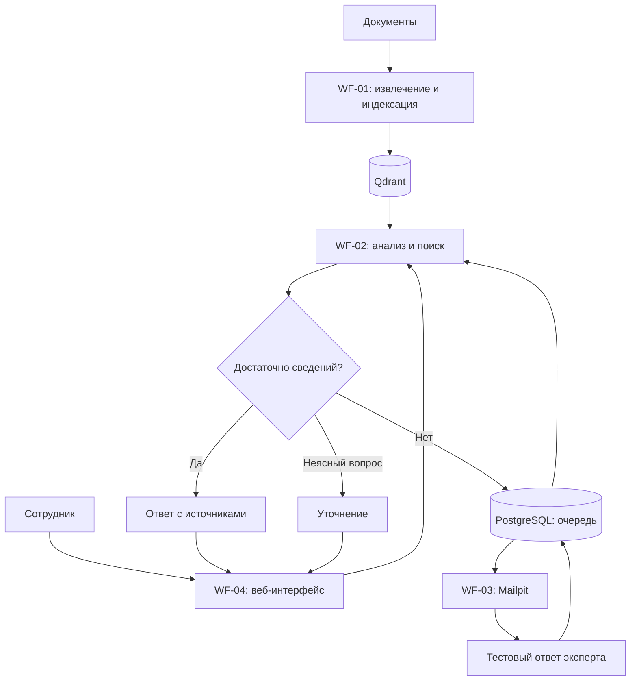

# Корпоративный ИИ-помощник по регламентам

Конкурсный проект хакатона **«ИИкузница — 2026»**, задача Софтлайн «Поиск ответов по корпоративным документам».

## Цель

Сократить риск неподтверждённых ответов существующего корпоративного помощника и снизить число повторяющихся обращений в службу качества. Ответ должен опираться на применимый регламент; при неоднозначности помощник уточняет вопрос, при недостатке сведений — формирует обращение эксперту.

## Архитектура

| Workflow | Назначение |
|---|---|
| [WF-01](workflows/WF-01-document-ingestion.json) | PDF/DOCX → Tika → фрагменты с номерами пунктов → локальные E5-эмбеддинги (384) → Qdrant |
| [WF-02](workflows/WF-02-corporate-assistant.json) | Анализ вопроса → гибридный поиск → ответ со ссылками / уточнение / очередь |
| [WF-03](workflows/WF-03-quality-mailpit.json) | Каждую минуту: отправка обращений, поиск и проверка экспертных ответов, запись в PostgreSQL |
| [WF-04](workflows/WF-04-employee-interface.json) | Веб-интерфейс сотрудника; отдельный ключ доступа к API |

**Стек демонстрации:** n8n, PostgreSQL, Qdrant, Ollama E5-small, Apache Tika, Mailpit, Caddy, Qwen3-Next-80B-A3B-Instruct через ProxyAPI.

Генерация и анализ вопроса в демонстрации используют внешний API. Это **не полностью закрытый контур**. Только обезличенные конкурсные данные. Для промышленной эксплуатации предусмотрена локальная языковая модель; требуется проверка доступных вычислительных ресурсов.

## Результаты контрольной проверки

- Четыре DOCX; независимый подсчёт Qdrant подтвердил 178 фрагментов.
- 13/13 контрольных запросов по основному ожидаемому результату, включая отказ на посторонний и пустой запрос, применение тестового разъяснения, запрет вопреки инструкции пользователя. Проверки преимущественно по одному регламенту; точность всех формулировок не гарантируется.
- Уточнение объекта доступа и продолжение той же сессии (№216/220).
- Автоматическая отправка заявки в Mailpit (№144, обращение 143), сохранение и повторное использование тестового экспертного ответа.
- Приоритет регламента в синтетическом конфликте (№95).
- Защита API: HTTP 403 без ключа, OPTIONS 204, HTTP 200 с ключом, HTML 200 (№232). Интерфейс проверен в браузере.

## Экономика

Сценарное обоснование промышленного внедрения на имеющейся инфраструктуре: 2100 запросов в месяц (оценка 100 за рабочий день, 21 день), предотвращение обращений по 5/10/20% всех запросов — допущения, не измеренная статистика. При 10 минутах на обращение, 1000 руб./ч, сопровождении 4000 руб./мес. и разовом внедрении 60 000 руб. условный чистый эффект 13 500 / 31 000 / 66 000 руб./мес.; простой условный срок окупаемости 4,44 / 1,94 / 0,91 месяца. Высвобождение времени не равно денежной экономии. Достаточность оборудования и трудозатраты необходимо подтвердить пилотом. Подробный расчёт — в отдельном Excel конкурсного пакета.

## Развёртывание и ограничения

Публичные JSON не содержат привязок credentials. Импортируйте четыре workflow, настройте PostgreSQL, Qdrant, Ollama, Tika, Mailpit, модель и отдельный Header Auth. Восстановите утверждённый корпоративный глоссарий в WF-02. Подставьте адрес собственного сервера в WF-04 и разрешённые origins WF-02. Не публикуйте входные точки без защиты; WF-01 в демонстрации не опубликован. Перед запуском проверьте настройки и доступность внутренних сервисов. Тестовые разъяснения 84/88 не являются утверждёнными нормами: их следует исключить из эксплуатационной базы.

Не подтверждены OCR сканов, замена редакции документа, промышленная нагрузка и отказоустойчивость, локальная генерация с приемлемой скоростью, реальная корпоративная почта и персональная аутентификация. Проверка ссылок не является автоматическим доказательством смысловой верности ответа. При сбое отправки статус sending требует ручной сверки.

[Дневник реализации](docs/IMPLEMENTATION_STATUS.md) · [Отладка и измерения](https://github.com/qqtq67-arch/ai-corporate-docs-agent/issues/1)
